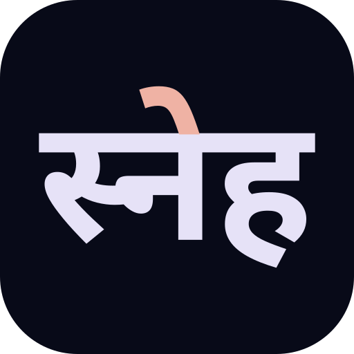
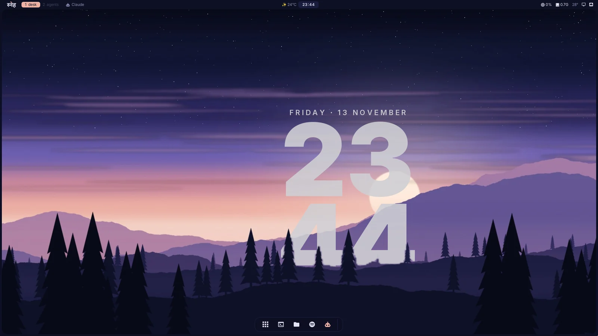

<p align="center">
  
</p>

<h1 align="center">स्नेह · Sneh</h1>

<p align="center">
  <b>A small, fast, agent-first Arch Linux for old machines, including ones with no monitor at all.</b><br>
  <i>sneh</i>: "affection", in Hindi and Sanskrit
</p>

<p align="center">
  
</p>

Sneh turns a 4 GB DDR3 mini PC (or any x86-64 UEFI machine) into a quiet, quick desktop that AI coding agents can live on. Flash a USB stick from Windows or Linux and plug it in. The machine either installs itself with nothing to type, or opens a graphical installer if it has a screen.

## Highlights

- **Two install styles on one stick.**
  - **Unattended:** answer everything in the flasher and the machine installs itself headless. Watch it over SSH if you like.
  - **Graphical:** a full-screen installer on the machine asks the questions, for laptops and desktops with a screen.
- **Net or full.** Download packages during the install, or carry every package on the stick and install with no internet.
- **Two editions.**
  - **desktop:** a headless box reached over VNC, with no audio stack and no sleep.
  - **laptop:** a real screen, battery, audio, Bluetooth and a lock screen.
- **Two workspaces.**
  - **desk:** the everyday desktop, with a wallpaper, a header bar, and a dock that has a tab for every window.
  - **agents:** plain, full-screen tmux sessions for agents, side by side.
- **Agent-first.**
  - Claude Code and opencode come preinstalled (optional), with a system manual (`AGENTS.md`) and skills.
  - The `sne` CLI answers in JSON, and `sne gui` lets an agent see and drive the desktop over SSH.
  - The bar shows your Claude plan usage and when it resets.
- **Light.**
  - About 0.7 GB of RAM at idle and 1.8 GB on disk. In a test VM it boots to the desktop in about 14 s.
  - Swap is zram, and earlyoom guards memory.
  - Background services that nothing on a headless box uses are switched off.
- **Looks.**
  - The *dusk* theme: night navy, lavender and one peach accent, plus seven more themes.
  - Its own wallpaper, *dusk ridge*, with a big clock drawn *behind* the trees. Firewatch wallpapers are an optional download.
  - `Super+/` lists every shortcut.
- **Optional apps** picked at install and changeable later: Thunar, VLC, an image viewer, mpv, Firefox, and Spotify (the app plus a Spotify Connect speaker).

## Quick start

You need a USB stick (4 GB, or 8 GB for an offline stick). **The stick and the target's disk are erased.**

1. Get the code:
   ```powershell
   git clone https://github.com/ogshrug/sneh-os.git
   cd sneh-os
   ```
2. Flash the stick on **Windows** with PowerShell 7.4+ (`winget install Microsoft.PowerShell`), in an Administrator terminal:
   ```powershell
   pwsh -File flasher\sneh-flash.ps1
   ```
   On **Linux**, fill in a copy of `flasher/sneh.conf.example`, then:
   ```sh
   sudo ./flasher/sneh-flash.sh -c my.conf -d /dev/sdX
   ```
3. In the target's firmware: UEFI on, CSM/Legacy off, Secure Boot off, USB first.
4. Boot the target from the stick:
   - **Unattended stick:** plug in Ethernet and walk away. After a 30-second countdown it erases the disk, installs and reboots.
   - **Graphical stick:** follow the installer, press **Install**, then **Restart now**.
5. Connect:
   ```sh
   ssh <user>@<hostname>.local
   ```
   For the desktop, point TigerVNC ≥ 1.13 or RealVNC Viewer at `<hostname>.local:5900`.

The stick switches its own boot loader off after a successful install, so leaving it in is harmless. Step-by-step guide: [docs/installing.md](docs/installing.md).

## Day to day

```sh
sne status              # memory, zram, temps, services, agents (add --json to anything)
sne doctor              # health checks with fix hints
sne attach              # the persistent tmux session "agents"
sne gui screenshot      # what's on screen, for you or an agent
sne theme set dusk      # dusk ink rose red-august teal aether olive blue-hour
sne wallpaper pick      # pictures with the depth clock (or: sne wallpaper set ~/pic.jpg; fetch = Firewatch set)
sne apps add vlc        # optional apps: files spotify vlc mpv firefox images
sne desktop off         # give agents all the RAM; sne desktop on brings it back
sne update              # system + Sneh + agents
sne snapshot create "before an experiment"; sne snapshot undo N
```

| Keys | Action |
|---|---|
| `Super+/` | every shortcut, searchable (Enter runs it) |
| `Super+1` / `Super+2` | the two workspaces: **desk** / **agents** |
| `Super+A` | agents workspace; pressed there: one more agent terminal, side by side |
| `Super+Return` · `Super+Space` · `Super+E` | terminal · launcher · files |
| `Alt+Tab` | switcher (hidden apps too); opens the pick full-screen |
| `Super+D` | desk: tuck all windows away / bring them back (on agents: go to the desk) |
| `Super+Q` / `Super+Shift+Q` | close (Spotify only hides) / really quit |
| `Super+Shift+W` / `Super+Alt+W` | wallpaper picker / next wallpaper |

## Requirements

- An x86-64 machine with **UEFI** (nearly everything from 2012 on). Legacy-BIOS-only machines are not supported.
- **RAM:** 2 GB minimum, 4 GB is comfortable. The graphical installer wants 3 GB.
- **Disk:** 16 GB minimum.
- **CPU:** Claude Code and opencode need **SSE4.2**: any Intel Core since 2008, Bay Trail or newer Celerons, or AMD since 2011. `sne doctor` checks it.
- **Headless iGPUs:** some refuse to start without a display. A $5 HDMI dummy plug fixes that.

## Documentation

| | |
|---|---|
| [Installing](docs/installing.md) | flashing, install styles, editions, net vs full, the graphical installer, disk safety, rescue |
| [The `sne` CLI](docs/sne.md) | every command and setting |
| [Agents](docs/agents.md) | what Claude Code and opencode are told about the machine |
| [Customizing](docs/customizing.md) | Hyprland Lua, themes, packages, the dock |
| [Architecture](docs/architecture.md) | how the stick, installer and session fit together |
| [Troubleshooting](docs/troubleshooting.md) | when something doesn't work |

## Repository layout

```
flasher/     sneh-flash.ps1 (Windows) · sneh-flash.sh (Linux) · offline package repo builder
installer/   runs on the Arch live USB: network, disk, pacstrap, chroot setup; gui/ = the graphical installer
system/      the OS payload → /usr/share/sneh: the sne CLI, configs, themes, branding, agent docs, rootfs/
tests/       QEMU end-to-end test (unattended and graphical) and a Hyprland config validator
docs/        documentation
website/     the project website (static; build-docs.py renders docs/ into website/docs/)
```

## Testing

`tests/qemu-e2e.ps1` runs the real thing. It flashes a stick and boots it in a UEFI VM with 4 GB of RAM and an empty disk. Then it installs, cold-boots the result and checks it:
- SSH, the desktop and VNC
- zram
- screenshots, clicks and typing through `sne gui`
- theme switching and `sne doctor`
- the default wallpaper and the fuzzel mouse-wheel fix
- boot time and failed units

Switches:
- `-Mode full -Offline`: proves the offline stick needs no network.
- `-Edition laptop`: tests the laptop edition.
- `-Gui`: drives the graphical installer with an answers file and captures its screens.

`tests/validate_hypr.py` checks the Hyprland Lua config against Hyprland's own API stubs.

## Credits and licences

- Sneh is released under the [MIT licence](LICENSE).
- Built on **Arch Linux** and **Hyprland**. It is not affiliated with either.
- The logo is the word स्नेह set in **Noto Sans Devanagari** Bold, drawn by `system/branding/make-logo.py`. The font ships in `system/fonts/` under the SIL Open Font License 1.1 (`system/branding/OFL-NotoSansDevanagari.txt`).
- The default wallpaper, *dusk ridge*, is Sneh's own: drawn by `system/wallpapers/make-dusk-ridge.py` and MIT-licensed with the rest.
- The optional **Firewatch** set is fan-shared art from wallhaven.cc. It belongs to its owners (Campo Santo / Olly Moss). Sneh does not redistribute it: it is downloaded on your own machine, for personal use, only if you ask for it (at install, from the wallpaper picker, or with `sne wallpaper fetch`).
- fuzzel 1.15.0 is rebuilt on the machine with a two-line upstream fix for mouse-wheel scrolling (`system/patches/fuzzel`, MIT) until Arch ships a fixed release.
- The look is inspired by [Ryoku](https://ryoku.dev) and the approach by Omarchy. Sneh shares no code with either.
